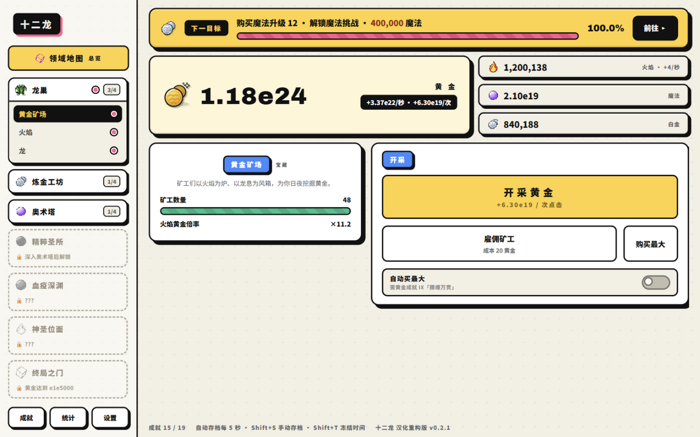
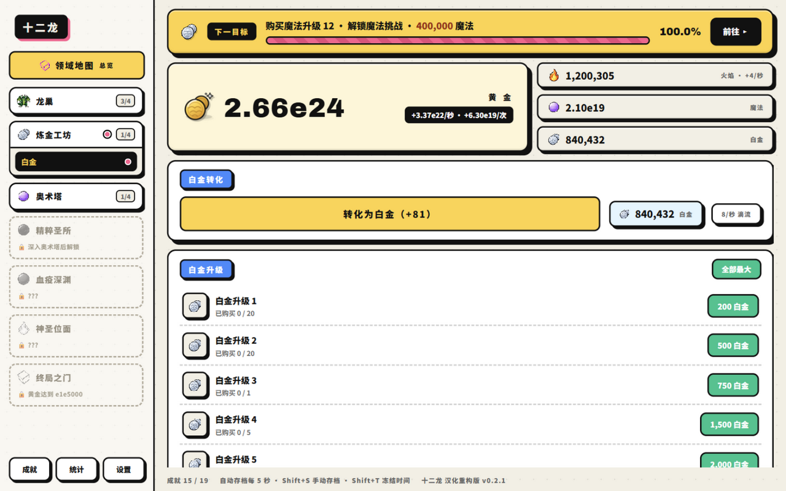
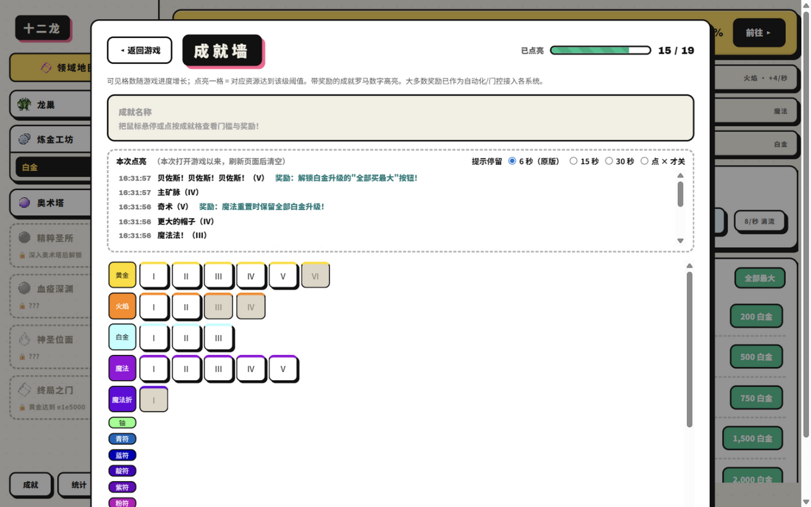

# 十二龙 · DodecaDragons 汉化重构版

> 恶龙盘踞金山，增益层层叠置 —— 一款纯网页放置类增量游戏的全中文版本。

## 这是什么游戏

从一枚金币开始：雇矿工、点火焰、喂养你的幼龙。数字会一路指数膨胀，
穿过 **龙巢 → 炼金工坊 → 奥术塔 → 精粹圣所 → 血疫深渊 → 神圣位面 → 终局之门**
七大领域，层层转生、增益叠置，直到与大数本身对话。

- **纯网页，零安装** —— 浏览器打开即玩，进度自动保存在本地，5 秒一存，随时关页面。
- **放置友好** —— 挂机照样推进度；切走标签页、关电脑再回来，产出按真实时间补足，还可以开启离线收益结算。
- **全中文** —— 界面、升级、成就、热键、彩蛋全部中文化，术语统一。

## 你能玩到什么

| 领域 | 玩什么 |
|---|---|
| 🐉 龙巢 | 矿工产金、火焰倍增、喂养幼龙 |
| ⚗️ 炼金工坊 | 白金 / 铀 / 钚 / 鿫 四条转生链 |
| 🔮 奥术塔 | 魔法、虚空魔法与魔法挑战 |
| 💎 精粹圣所 | 八色符印、知识圣典、光暗死亡终局四精粹 |
| 🩸 血疫深渊 | 血液九狱、宇宙瘟疫 |
| ✨ 神圣位面 | 圣火、行星、神圣多面体 |
| 🚪 终局之门 | 终局魔方、全能超神、以及十二龙 |

**38 个推进档位、300+ 项成就、12 条龙**——终点比想象中远得多。

## 一些贴心设计

- 大数引擎一路算到多层指数（ee 级），后期读数依然精确不糊
- 成就墙带解锁回放与提示停留，成就本身就是一套自动化开关
- 键盘热键随手买，Shift+T 还能冻结时间（试试看）
- 数字显示支持科学计数 / 上标幂两种口味，设置里随时切换

## 反馈与支持

玩到卡关、数值不对、文案别扭、或者只是想要一个新功能 ——
都欢迎到 [**Issues**](https://github.com/shenlq1017/aurum-codex/issues) 里说一声，越具体越好（大概进度、做了什么、期望 vs 实际）。

如果这只龙陪你挂过一会儿机，给仓库点个 **Star ⭐** 就是最大的鼓励，也会让更多人看到它。

---

*爱好者汉化重构项目，仅供学习交流。*
